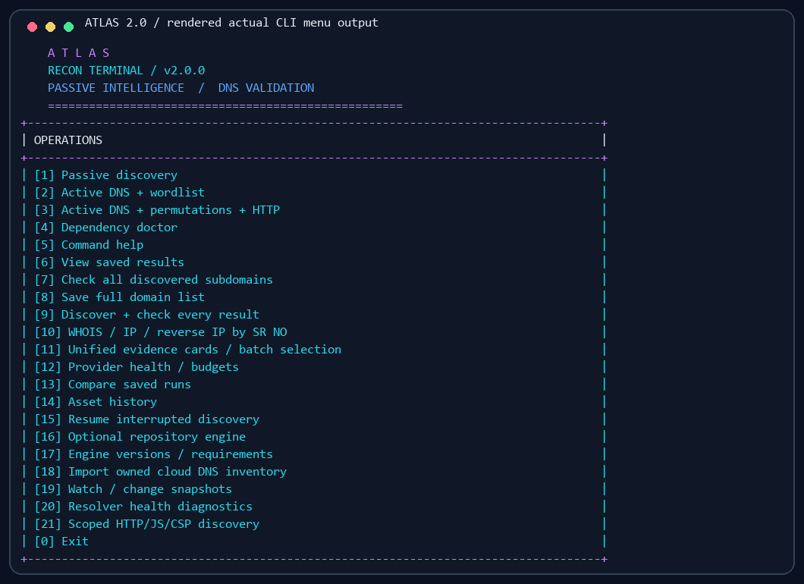
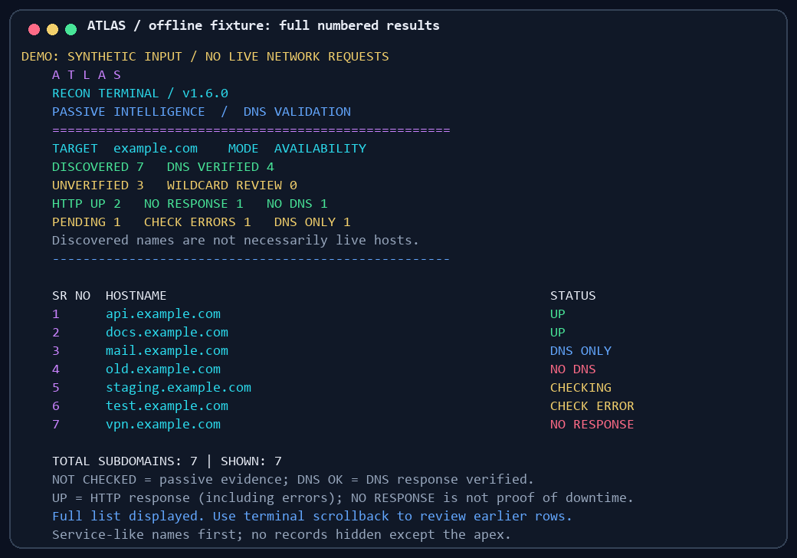
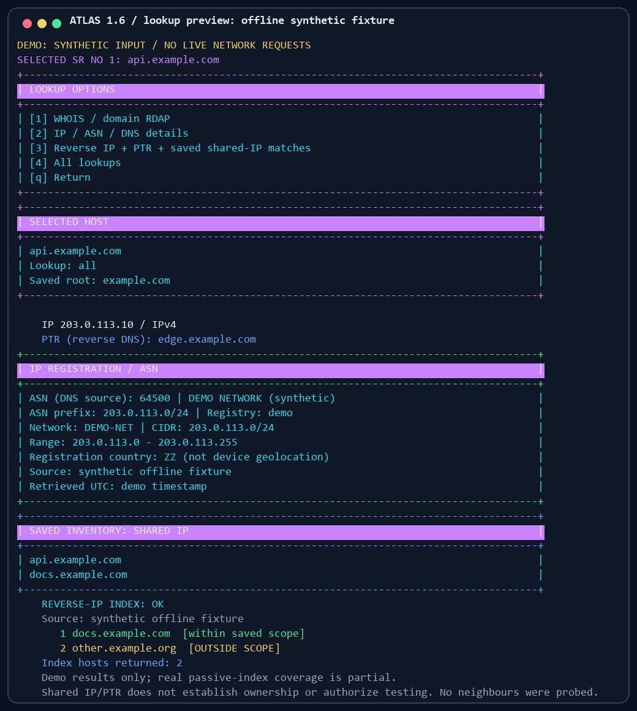

# ATLAS Recon

**Colorful subdomain discovery, DNS reconnaissance and background availability checks—entirely in your terminal.**

[](https://github.com/whitedevil200/atlas-recon/actions/workflows/tests.yml)
[](https://www.python.org/)
[](LICENSE)
[](https://github.com/whitedevil200/atlas-recon/releases)

ATLAS is a colorful **CLI reconnaissance workspace** for scoped subdomain discovery, DNS/HTTP checks and saved evidence. Discover names, read the **full numbered list**, select a subdomain by **SR NO**, run lookups or specialist engines, and compare observations over time. Linux uses a Bash menu; Windows uses a Python-backed launcher. There is no graphical dashboard.

## Active-workflow fixes in 2.1.2

Menu options **2** and **3** now use a quick passive stage, a 30-second external
stage limit and 3-second DNS timeout, followed by visible DNS progress. They no
longer wait for the full default passive-tool timeout before DNS starts.
DNS retries transport/server errors through up to three configured resolvers,
remembers a working resolver, and preserves attempts. Definitive negative answers
do not trigger retries. No public resolver is silently added.

Permutation seeds now include wordlist candidates when no passive names were
available. Real HTTPx JSON uses an IP in `host` and DNS identity in `input`; the
parser handles both and saves HTTP availability in the numbered list. A 403/404
is **UP** because a server responded. Partial DNS-type failures retain valid
address evidence and error details. TLSx full JSON metadata uses compatible probe
flags; SAN/CN output-only flags are not combined with other probes.

Bounded checks of `google.com` verified wordlist and permutation/HTTP workflows
with `api`, `mail` and `www`. This verifies those small workflows, not exhaustive
Google enumeration. More names depend on the selected seeds, wordlist and scope.

## Free engine bundle in 2.1

The normal Linux/Windows installers now install **seven free engines** into ATLAS's
managed directory: Subfinder, Findomain, DNSx, AlterX, HTTPx, TLSx and Katana.
ATLAS automatically finds them; no Go/Rust compiler or manual PATH changes are required.
Installation needs internet access and downloads roughly 75–100 MB depending on platform.
Supported bundles: Linux x86_64/arm64 and Windows x86_64 (other Windows systems can use WSL).

**No paid API is required.** Censys, SecurityTrails and account-dependent Chaos are
disabled. Subfinder uses an explicit keyless-source allowlist; Findomain excludes
account/paid sources. Free public endpoints still have quotas and outages.

```bash
# Included in bash install.sh and install-windows.cmd by default
atlas setup-engines
atlas setup-engines --list
atlas engines --check
# Within an authorized scope: native DNS + DNSx, AlterX and HTTPx/TLSx evidence
atlas scan -d example.com --mode active --authorized --permute --http --free-engines
# Katana remains an explicit crawl action on selected saved assets
atlas engine katana RUN --serial 1-3 --authorized --rate 5
```

In PowerShell use `.\atlas.cmd` instead of `atlas`. Menu **22** installs/repairs
the bundle; menu **3** enables the advanced free-engine pipeline. Normal passive
scans use bundled Subfinder/Findomain automatically. AlterX runs with `--permute`;
DNSx and HTTPx/TLSx enrichment run with `--free-engines` (TLS/HTTP additionally
need `--http`). `--offline` skips passive sources; explicitly selected active DNS/HTTP/engine actions still run.
The other open-source interoperability adapters remain optional/manual;
**this is a seven-engine bundle, not an all-17-engine distribution**.

Versions, OS/architecture, download URLs, sizes and archive SHA-256 values are
pinned in `atlas_data/engines.lock.json`. Installation verifies the archive before
extracting a single executable, records the binary hash and upstream notices,
and can safely retry a failed download. Re-running setup checks installed hashes.
`ATLAS_ENGINE_HOME` selects a different managed directory. For a minimal core-only
installation set `ATLAS_SKIP_ENGINES=1` before running the installer.
Binary downloads happen during setup, never implicitly during a scan. Upstream
licenses still apply; ATLAS does not relicense their executables.

## What's new in 2.0

- SQLite inventory with stable asset IDs, observation history and source records.
- Atomic discovery checkpoints, input hashes and resume; interrupted availability checks resume pending names without rechecking completed rows.
- Bounded DNS recursion and generation, TTL-aware caches, DNS response/error states, resolver metrics and optional trusted-resolver comparison.
- Unified evidence cards and batch selection such as `2,5,8-12`.
- Coverage-aware diffs, persistent watch snapshots, incremental CT cursors and an opt-in notification outbox.
- **17 repository references:** free executable/import profiles plus a disabled Chaos compatibility record. Separate HTTP/TLS, DNS, passive discovery, mutation and crawl profiles expose explicit actions rather than silently installing upstream engines.
- Native free Common Crawl source actions; read-only imports of AWS Route53, Cloudflare and Google Cloud DNS exports.
- Scoped HTTP/JavaScript/CSP candidate discovery, explainable review leads, portable Python packaging and a hashed runtime dependency lock.

See the [2.0 implementation matrix and upgrade notes](docs/UPGRADE-2.md),
[engine/source/configuration reference](docs/ENGINES.md),
[third-party licenses](THIRD_PARTY.md) and [benchmark protocol](docs/BENCHMARK.md).
Tests use controlled fixtures and mocked external-tool/provider responses. The
adapter list does **not** claim every upstream binary is installed or live-tested.

## First run

From a source checkout, install using the Linux or Windows instructions below,
then type `atlas` or `.\atlas.cmd` to open the menu. To test without contacting
providers or target hosts, put names in a file and import them:

```bash
printf 'api.example.com\nwww.example.com\n' > evidence.txt
atlas scan -d example.com --offline --import evidence.txt --no-lookup
```

PowerShell equivalent after `.\install-windows.cmd`:

```powershell
Set-Content -Path evidence.txt -Value @('api.example.com', 'www.example.com')
.\atlas.cmd scan -d example.com --offline --import evidence.txt --no-lookup
```

The command prints a saved run directory. In subsequent examples, replace
`RUN` with that exact path; `OLD` and `NEW` mean two saved run directories.
Passive public-source collection uses `atlas scan -d example.com --profile quick`.
Use active checks only within an authorized scope.

## Terminal previews







These images render captured output from the actual CLI for documentation; they are **not desktop screen captures**. The results and lookup previews use explicitly labeled offline synthetic fixtures, not live scans of example.com. The real CLI prints every matching name; use terminal scrollback for large lists.
The menu preview captures 2.0; the results/lookup previews illustrate the
established workflow retained in 2.0. Terminal width, fonts and optional Rich affect appearance.

## Features

- Automatic colorful Bash menu on Linux; Python-backed launcher on Windows.
- Passive sources: crt.sh, paginated Cert Spotter, HackerTarget and Wayback CDX.
- Optional Subfinder, Assetfinder and Findomain adapters with source attribution.
- DNS wordlists, bounded iterative expansion under validated names, learned naming tokens in deep mode, and optional AlterX permutations.
- A/AAAA/CNAME evidence, configurable resolvers, wildcard-suspect classification and optional PureDNS/massdns validation.
- Bounded background DNS/HTTP checks for **every discovered subdomain**, with checkpoints.
- Full numbered results, color-coded statuses, search, refresh and file saving.
- Select a result by **SR NO** for WHOIS/domain RDAP, IP registration/ASN/DNS, or reverse-IP enrichment.
- Text/CSV/JSONL exports, raw evidence, timestamps and a man page.
- Persistent history, provenance, checkpoint/resume, coverage-aware comparisons and the 2.0 workflows above.

**No tool guarantees finding every subdomain.** Private DNS, unknown labels, archive/certificate coverage, API quotas and exclusions limit results. ATLAS makes no exploit or takeover claims.

## Install on Linux

Requires Python **3.10+**, Bash and Python venv support. Ubuntu/Debian/Kali:

```bash
sudo apt-get update
sudo apt-get install -y git python3 python3-venv figlet
git clone https://github.com/whitedevil200/atlas-recon.git
cd atlas-recon
bash install.sh
export PATH="$HOME/.local/bin:$PATH"
atlas
```

Run `install.sh` without sudo. It creates a local `.venv`, user-local launcher and man page. Keep the repository folder in place: the launcher points to it. Add the PATH export to your shell configuration for future terminals. `figlet` is optional; a colored fallback banner works without it.

Without installing the launcher: `bash atlas` from the repository folder.

### Python package / pipx installation

From the checkout, use an isolated environment for a Python console entry point:

```bash
python3 -m venv .venv
. .venv/bin/activate
python -m pip install -e .
atlas
```

On Windows, the corresponding environment command is
`.\.venv-windows\Scripts\python.exe -m pip install -e .`; use
`.\.venv-windows\Scripts\atlas.exe` if it is not on PATH. Installing
`'.[terminal]'` enables the optional Rich dependency; the ANSI menu also works
without it. The launcher remains CLI-only.

If pipx is already installed, `pipx install .` from the checkout installs the
console command in a dedicated environment. `pipx ensurepath` may require a new
terminal. No PyPI publication is implied: these commands install this checkout.

For a fixed runtime dependency set:

```bash
python -m pip install --require-hashes -r requirements-runtime.lock
python -m pip install --no-deps -e .
```

The lock includes runtime transitives, excludes build/development tools and Rich,
and was resolved for Python 3.10. Review updates explicitly. Engine executables
are separate optional installations; the Python package does not install them.

## Install on Windows PowerShell

Install Python 3.10+ and Git first:

```powershell
git clone https://github.com/whitedevil200/atlas-recon.git
cd atlas-recon
.\install-windows.cmd
.\atlas.cmd
```

The installer creates `.venv-windows` inside the toolkit. No Bash, WSL, execution-policy change or system PATH modification is needed. PowerShell needs `.\` for programs in the current folder.

To type just `atlas` in the current PowerShell session:

```powershell
$env:Path = "$($PWD.Path);$env:Path"
atlas
```

See [Windows troubleshooting](WINDOWS-QUICKSTART.md). You can fully extract a [release ZIP](https://github.com/whitedevil200/atlas-recon/releases) instead of cloning.

## Menu

| Number | Action |
|---|---|
| 1 | Passive discovery |
| 2 | Active DNS + wordlist |
| 3 | DNS + permutations + optional HTTP metadata |
| 4 | Dependency doctor |
| 5 | Command help |
| 6 | Full numbered results |
| 7 | Check every discovered subdomain |
| 8 | Save all names |
| 9 | Discover + background availability checks |
| 10 | WHOIS / IP / reverse IP: select a subdomain by SR NO |
| 11 | Unified saved evidence cards; single or batch SR NO |
| 12 | Provider health, source yield and budgets |
| 13 | Compare two saved runs |
| 14 | Asset observation history |
| 15 | Resume interrupted discovery or availability checks |
| 16 | Run an optional repository engine on saved scope |
| 17 | Engine versions and configuration requirements |
| 22 | Install / repair seven free engines |
| 18 | Import owned cloud DNS inventory |
| 19 | Watch and save change snapshots |
| 20 | Resolver connectivity and response diagnostics |
| 21 | Scoped HTTP/JS/CSP discovery |
| 0 | Exit |

Colors are enabled by default in the launcher. `NO_COLOR=1 atlas` disables them on Linux. Explicit control: `atlas --color always COMMAND` or `atlas --color never COMMAND`. Direct `python3 atlas.py` also opens a menu.

## Discover and check

On PowerShell replace `atlas` below with `.\atlas.cmd`. Active checks require authorized scope.

```bash
# Passive discovery
atlas scan -d example.com

# Discovery followed by checks of every discovered name
atlas scan -d example.com --check-live --authorized --workers 8 --rate 10

# DNS wordlist discovery
atlas scan -d example.com --mode active --authorized -w words.txt

# Bounded expansion and optional permutations
atlas scan -d example.com --mode active --authorized --permute \
  --recursive-depth 1 --max-candidates 10000 --exclude vendor.example.com

# Offline evidence import; no network requests in passive mode
atlas scan -d example.com --offline --import evidence.txt

# Select passive providers and bound CT pages
atlas scan -d example.com --sources certspotter,hackertarget --ct-pages 5
```

The scan prints its saved directory. Replace the placeholders below with that **actual folder path**.

## Look up a discovered subdomain

**Immediately after discovery**, the menu and interactive CLI offer `[l] WHOIS / IP / reverse-IP lookup`. Press **l**, enter the subdomain's **SR NO** from the list just displayed, and choose a lookup. The current run is selected automatically; no folder path re-entry is needed. After `--check-live`, lookup uses the newly checked results. Press Enter to finish instead. Use `--lookup` to force this workflow or `--no-lookup` for scripts; redirected/non-interactive scans do not prompt by default.

```bash
atlas scan -d example.com --lookup
```

Open `atlas`, choose **10**, enter a saved run directory, and select the **SR NO** next to the subdomain. Choose:

| Lookup | Information shown |
|---|---|
| 1: WHOIS / RDAP | Registered parent, registrar, disclosed registrant, registration/expiration events, domain status, nameservers and DNSSEC registration fields |
| 2: IP details | Current A/AAAA/CNAME/MX/NS/TXT/CAA/SOA records with TTLs, IPv4/IPv6 addresses, PTR, IP network/range/CIDR, RIR and ASN; RIPEstat routing fallback when ASN DNS fails |
| 3: Reverse IP | PTR, shared IP matches in saved A/AAAA evidence, and hostnames returned by HackerTarget's passive reverse-IP index |
| 4: All | Run all three lookups for the selected subdomain |

While browsing results with menu **6**, press **l** to select a serial number from the current full or searched list. Serials follow the displayed order, exclude the apex, and start at 1 in each filtered view. Results can change between saved runs; always select from the same directory and filter.

```bash
# Interactive numbered selection
atlas lookup results/YOUR_SAVED_RUN

# Select SR NO 3 from the unfiltered report
atlas lookup results/YOUR_SAVED_RUN --serial 3 --kind all

# Run an individual lookup
atlas lookup results/YOUR_SAVED_RUN --serial 3 --kind whois
atlas lookup results/YOUR_SAVED_RUN --serial 3 --kind ip
atlas lookup results/YOUR_SAVED_RUN --serial 3 --kind reverse-ip

# Match a searched report's numbering
atlas report results/YOUR_SAVED_RUN --find api.
atlas lookup results/YOUR_SAVED_RUN --find api. --serial 1 --kind all

# Refresh cached provider data, bound IPs and save JSON to a new file
atlas lookup results/YOUR_SAVED_RUN --serial 3 --kind all \
  --refresh --max-ips 4 --timeout 5 -o selected-host.json

# PTR + saved IP correlation without the HackerTarget index
atlas lookup results/YOUR_SAVED_RUN --serial 3 --kind reverse-ip --no-external

# Optional legacy WHOIS command, if your platform provides it
atlas lookup results/YOUR_SAVED_RUN --serial 3 --kind whois --legacy-whois
```

Lookups query the system DNS resolver, registration services and passive providers. They do not probe HTTP services, scan IP ranges, or automatically test reverse-IP neighbours. `--no-external` disables only HackerTarget; DNS/PTR, RDAP and the ASN routing fallback still use their respective services.

WHOIS uses **RDAP by default**, because [ICANN transitioned gTLD registration lookup to RDAP](https://www.icann.org/en/announcements/details/icann-update-launching-rdap-sunsetting-whois-27-01-2025-en). Domain endpoints come from the [IANA bootstrap](https://www.iana.org/assignments/rdap-dns/). [tldextract](https://github.com/john-kurkowski/tldextract) identifies the registered parent using its bundled public suffix snapshot, including names such as `api.example.co.uk`. Private platform suffixes are not registration boundaries: `alice.github.io` looks up `github.io`. Update requirements to update the bundled snapshot; `--refresh` refreshes provider data, not the suffix list. Some ccTLDs lack RDAP; optional `--legacy-whois` invokes the installed `whois` command with a timeout. Registration is for the parent domain, not proof of a subdomain's owner or availability. Redacted contacts remain undisclosed.

[ipwhois](https://github.com/secynic/ipwhois) supplies IP RDAP/ASN data. If ASN DNS fails, registry RDAP can still run via bootstrap and [RIPEstat](https://stat.ripe.net/docs/data-api/api-endpoints/network-info.html) supplies observed routing origins/prefixes over HTTPS. Multiple routing origins are preserved. Registration country is **not device geolocation**. PTR is reverse DNS and is **different from** the passive reverse-IP index. Shared hosting/CDN neighbours may be unrelated; excluded names and names outside your saved root are labeled **OUTSIDE SCOPE** and never added to discovery evidence or probed.

HackerTarget's IPv4 index has partial coverage, provider quotas and result limits ([provider documentation](https://hackertarget.com/reverse-ip-lookup/)); it does not establish current hosting. IPv6 receives PTR/local correlation, with the external index labeled unsupported. Non-public IPs skip provider enrichment. Defaults: at most **8 IPs**, **8 seconds per request**, no automatic provider retries or recursive contact queries. Increase `--max-ips` up to 32; omitted addresses are listed. A full lookup can take several request timeouts.

Every completed lookup automatically saves raw and structured JSON under `RUN/lookups/`; `-o` chooses a different **new** file. Successful provider results cache for one hour in `RUN/lookups/cache/`; IANA bootstrap caches for 24 hours. DNS is queried fresh. Cache hits show the original retrieval timestamp; `--refresh` bypasses caches. Provider errors, quotas, DNS timeouts, unsupported results and IP limits are visible. Partial lookups retain successful sections and return exit code **1**. Explicit output files are never overwritten. Local lookup evidence/caches are excluded from Git.

Existing installation? Run `git pull`, then rerun `bash install.sh` or `.\install-windows.cmd` to install the new Python dependencies. Legacy WHOIS is optional (`sudo apt-get install whois` on Debian/Ubuntu).

```bash
# Full list is automatic: no pagination or --all needed
atlas report results/RUN_FOLDER
atlas browse results/RUN_FOLDER
atlas report results/RUN_FOLDER --find api --details

# Check an existing list; original discovery is preserved
atlas check results/RUN_FOLDER --authorized --timeout 5 --workers 8
atlas check results/RUN_FOLDER --authorized --dns-only
```

The viewer supports **r** refresh, **s** search, **w** save, **l** lookup and **q** exit. All matching names appear immediately with serial numbers.

## Evidence, history, resume and changes

```bash
atlas evidence RUN --serial 2,5,8-12
atlas health RUN
atlas history api.example.com --database results/atlas.sqlite3 --root example.com
atlas diff OLD NEW -o changes.json
atlas resume RUN --no-lookup
atlas resume CHECKED_RUN --authorized --no-lookup
```

Serials refer to the displayed order, not stable database identity. `--find api`
filters evidence/engine selection before numbering. History uses the shared
database beneath the output parent by default; pass `--database` if you chose
another location. Importing old results into a new scan does not reconstruct
unrecorded historical evidence.

Resume preserves the original scope, input hashes and budgets. Changed or missing
inputs require a new run. Completed provider stages and validated DNS candidates
are skipped; an interrupted external action may need to restart that action.
Availability resume skips completed rows and checks `PENDING` rows. Active or
availability resume requires `--authorized`. An exhausted original budget is not
automatically increased. Version 1.x results without a 2.0 checkpoint cannot be
resumed; view/export them or import their names into a new run.

Diffs show **new**, **changed**, **not observed**, coverage regressions and whether
the collection settings/coverage are comparable. Collection timestamps, cache
state, TTL countdowns and row numbering do not create asset-change alerts.
Missing from one run means not observed; it does not prove deletion or downtime.

```bash
# Two snapshots; no message delivery by default
atlas watch -d example.com --cycles 2 --interval 300

# Continue the saved CT cursor while retaining prior candidates
atlas watch -d example.com --sources certspotter,subfinder --cycles 2 --incremental

# Explicit delivery to your configured Notify destinations
atlas watch -d example.com --cycles 2 --notify --notify-config notify-provider.yaml
```

Watch defaults to one cycle; `--cycles 0` continues until interrupted. Its
persistent state includes the previous run, deduplication digest and pending
notification outbox. Failed deliveries are retained with backoff and capped
attempts; `--retry-notifications` explicitly retries retained failures. Notify must
be installed and configured separately. Keep provider configuration outside Git.
Incremental runs retain candidates and are useful for additions; they do not
establish that old names disappeared.

## Specialist engines, passive sources and owner exports

```bash
atlas engines
atlas engines --check
atlas engine httpx RUN --serial 1-3 --authorized --rate 10 --limit 100
atlas engine tlsx RUN --serial 1-3 --authorized --rate 5
atlas engine amass RUN --authorized --import-file amass-export.jsonl
atlas source commoncrawl -d example.com --limit 100
atlas owner-import aws route53.json -d example.com --authorized --view private
atlas crawl RUN --serial 1-3 --authorized --requests 20 --depth 1
```

The executable profiles include Subfinder, Assetfinder, Findomain, DNSx, PureDNS,
MassDNS, ShuffleDNS, AlterX, Gotator, HTTPx, TLSx, BBOT 3.x, Notify, Katana and
BadDNS. Chaos is disabled in the free-only edition. **Amass is existing compatible JSONL import only**, not live v5
execution. Notify delivery is exposed through `watch --notify`, not arbitrary
engine arguments. All are optional; [the adapter matrix](docs/ENGINES.md) declares
actual commands, prerequisites, version checks, licenses and limitations.

Subfinder/Assetfinder/Findomain query the root domain even when rows are
selected. Other profiles consume selected scoped names. Mutation output is a
candidate list, not DNS proof. Certificate SANs, aliases and redirects can mention
outside domains as relationship evidence; they are not automatically probed.
BadDNS is an explicit bounded investigation profile, not resource claiming or
confirmed takeover. The built-in crawl pins validated public addresses and applies
scope and request/depth/time budgets to queued links and redirect destinations.
Redirects can be queued within the selected crawl depth; each fetched destination
is checked again rather than blindly following HTTP redirects.

Paid/account-dependent native sources are disabled even if API credentials are
present. Common Crawl uses one bounded latest-crawl page; `partial` can return a
nonzero code while retaining evidence.

Owner imports accept read-only DNS JSON exports from AWS Route53, Cloudflare and
Google Cloud DNS. They do not contact cloud APIs, discover credentials, write
zones or probe hosts. Complete provider pagination before importing. Owner data
is `probe_allowed=false`; private/public DNS view is explicit. Subsequent private
lookups, checks, engines or crawling require `--allow-private` in addition to the
operation's authorization flags. This is deliberate opt-in, not automatic private
network discovery.

## Budgets and source coverage

```bash
atlas scan -d example.com --mode active --authorized --profile deep \
  --recursive-depth 2 --max-candidates 5000 --max-queries 20000 \
  --max-seconds 900 --exclude vendor.example.com --rate 10
```

`quick` caps CT pages at 2 and guesses at 1,000 and uses a smaller default source
set; `balanced` preserves normal defaults. `deep` raises the CT-page budget to at
least 10 and active recursion depth to at least 2. All remain bounded; deeper
profiles do not guarantee discovery. Explicit DNS views, resolver files, trusted
resolver files, exclusions and imported inputs are recorded with the run.

`health` shows source state/yield, provider logical requests, resolver telemetry,
DNS query/time budgets and partial coverage. Logical provider requests are
instrumented operations, **not exact low-level HTTP attempts**. Provider tools
may perform internal queries/retries; adapters without native rate controls use
declared conservative concurrency or upstream defaults. TTL caches and trusted
resolver agreement improve assessment, but agreement is not authoritative truth
or local DNSSEC validation. See [engine budgets](docs/ENGINES.md) for exact adapter
limits and [benchmark methodology](docs/BENCHMARK.md) for measurement criteria.

## Save files

```bash
atlas export results/RUN_FOLDER -o domains.txt
atlas export results/CHECKED_FOLDER -o status.csv --format csv
atlas export results/CHECKED_FOLDER -o evidence.jsonl --format jsonl
atlas export results/CHECKED_FOLDER -o up.txt --availability UP
```

CSV includes serial numbers. Plain text exports keep one hostname per line for use in other tools. Existing files are preserved unless `--force` is explicit.

## Understand the status

| Label | Meaning |
|---|---|
| **UP** / green | HTTP/HTTPS responded, including redirects and 4xx/5xx errors. Not a claim the application is healthy. |
| **NO RESPONSE** / red | DNS addresses exist but neither HTTPS nor HTTP responded during checks. Not proof of downtime. |
| **NO DNS** / red | No usable A/AAAA address was returned. |
| **DNS ONLY** / blue | DNS addresses found; HTTP was not checked. |
| **CHECK ERROR** / yellow | A query/worker error prevented reliable assessment. |
| **CHECKING** / yellow | Pending result, including in interrupted runs. |
| **NOT CHECKED** / yellow | Passive evidence without independent availability checks. |
| **REVIEW** / magenta | DNS overlaps random sibling wildcard samples; review manually. |

Availability is timestamped and can change. HTTPS HEAD is tried first, then HTTP on port 80 if needed. Redirects are not followed and TLS validation remains enabled. Other ports and non-web services need separate assessment. Wildcard matching is heuristic.

## Output and limits

| File | Contents |
|---|---|
| `subdomains.txt` | Discovered scoped names, excluding apex |
| `assets.jsonl` | Source, DNS and optional availability evidence |
| `assets.csv` | Discovery inventory |
| `availability.csv` | Numbered availability inventory |
| `up.txt` | Names returning HTTP responses |
| `summary.json` | Counts, stages, settings and completion state |
| `raw/` | Provider responses and external command logs |
| `report.txt` | Readable saved inventory |
| `candidates.txt` | DNS guesses; not proof of discovery |
| `wildcards.json` | Random sibling DNS samples |
| `checkpoint.json` / `manifest.json` | Atomic recovery state and configuration/input fingerprints |
| `summary.json` → `provider_health` | Source health, collection yields and available budget telemetry |
| `engines/` | Explicit optional-engine action records and schema-projected evidence |
| `atlas.sqlite3` in the output parent | Persistent run/asset observations; WAL sidecars may exist while open |

Background checks create a separate checked run and preserve completed results on interruption. Open `atlas browse CHECKED_FOLDER` in a second terminal and refresh during checking. Raw discovery evidence stays in the original run referenced by `input_run`.

`--rate` bounds explicit check-operation starts, not internal DNS retries or OS lookups. Passive tools use their own provider pacing. Cert Spotter pages are capped by `--ct-pages`; `--ct-after` continues from a saved issuance ID. HackerTarget free responses are capped at 50 hosts. Source failures and missing tools mean reduced coverage.

## Optional external tools

Built-in sources/checks work without external engines. The normal installers
install the seven-engine free bundle automatically. Use `atlas setup-engines` to
repair it and `atlas engines --check` to inspect versions. Other free engines,
including PureDNS/MassDNS and BBOT, remain optional manual adapters with their
own runtime/configuration requirements. See [the adapter matrix](docs/ENGINES.md).

## Complete command and menu manual

Every command, positional argument, option/default and menu choice is explained
in [the complete manual](docs/MANUAL.md). It includes all menu entries 0–22,
lookup/browser controls, examples, output files, environment variables, status
meanings, recovery and troubleshooting.

On Linux use `man atlas` after installation, or `man -l man/atlas.1` from this
checkout. On Windows open `docs/MANUAL.md`; command-specific quick help remains
available with `.\atlas.cmd COMMAND --help`.

The editable detailed reference is `scripts/build-man.py`. Run
`python scripts/build-man.py` after changes, then
`python scripts/build-man.py --check` to verify every parser argument is covered
and the source/packaged man pages and readable manual match. CI checks coverage
and renders the Linux man page with groff.

## Help, tests and troubleshooting

```bash
atlas --help
atlas scan --help
atlas check --help
atlas lookup --help
atlas doctor
atlas engines --check
man -l man/atlas.1
python3 -m unittest discover -s tests -v
python3 scripts/check-wheel.py
bash -n atlas install.sh
```

PowerShell command not recognized? Use `.\atlas.cmd` in the extracted folder. Missing DNS module? Rerun your platform installer. Provider HTTP 429/502/timeouts mean source failure, not necessarily a startup failure.

Exit codes: **0** command completed, **1** discovery stage failure or partial lookup, **2** input/configuration error, **130** interrupted discovery. Interactive lookup cancellation returns to the menu. Completed checks may still contain per-host CHECK ERROR records; read the counts.

[Research notes](RESEARCH.md) · [Validation notes](VALIDATION.md) · [2.0 upgrade](docs/UPGRADE-2.md) · [Benchmark plan](docs/BENCHMARK.md). CI uses offline fixtures/mocks and does not scan public targets. The installed-wheel smoke check builds in a temporary directory, installs into a clean environment and imports synthetic names without reconnaissance requests.

## License and contributions

[MIT](LICENSE) applies to ATLAS's original code. External tools/services retain their own licenses and terms. Bug reports and focused pull requests are welcome; include your OS, command, version and sanitized error output.
